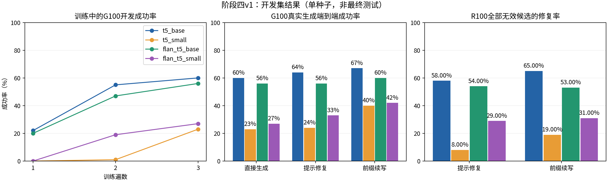

# 阶段四 v1：生成基线、执行器验证与两种复用修复

> 更新：2026-11-05（北京时间）。本文件完整描述阶段四v1的任务、首次运行顺序、续跑、指标与当前结果。状态：基线为T5-base、T5-small、Flan-T5-base、Flan-T5-small，使用统一流程；四模型训练与完整开发评价已完成，主模型为T5-base第3遍，最终测试未运行。

## 1. 阶段目标与范围

使用阶段三v1的4000条生成样本，分别从原始T5-base、T5-small及Flan-T5-base、Flan-T5-small预训练检查点微调生成模型。验证只用严格执行器；修复复用当前模型，通过提示修复和前缀续写两种方式，构成四个模型各三条流程：直接生成、生成→执行器→提示修复、生成→执行器→前缀续写。

开发200条按G100／R100分别评价。G100衡量真实生成失败的端到端修复；R100衡量相同受控无效候选的修复。有效路径保留由软件测试及G100原成功路径检查。两个面板不混合为一个成功率，R100的修复率不能当作G100的端到端成功率。

本版不含BART、自验证、多任务学习、单独验证/修复模型或多轮修复；不加载已删除的历史权重。

## 2. 已确认的配置与决策

### 2.1 训练与选择

| 项目 | 设置 |
| --- | --- |
| 模型 | `google-t5/t5-base`、`google-t5/t5-small`、`google/flan-t5-base`、`google/flan-t5-small`；两组分别固定revision |
| GPU与环境 | RTX A6000；`/home/user/miniconda3/bin/conda`，环境`gridpath` |
| 数据 | 4000G；开发100G＋100R；无V/R微调 |
| 更新 | 三遍、有效batch4、microbatch4，共3000更新／12000次样本呈现 |
| 优化 | 全参数AdamW，LR `1e-4`，预热12更新后恒定，weight decay `0.01`，梯度裁剪1.0 |
| 数值 | BF16、seed42、确定性算法，启动前设置`CUBLAS_WORKSPACE_CONFIG=:4096:8` |
| 解码 | greedy、自然EOS、256新token、最终路径72动作，无方向词清洗或强迫EOS |
| pilot | 每模型前10更新、40样本呈现，包含在三遍内；dev4只检查推理，不用于选择 |
| 检查点 | 每25更新保存latest；每1000更新评价G100及固定train-seen100诊断 |
| 单模型best | 按G100成功率、最优成功率、较低token NLL；同分保留较早检查点 |
| 跨模型主选择 | G100成功率、最优成功率，同分按T5-base、T5-small、Flan-base、Flan-small顺序；不跨tokenizer比较NLL |

每个模型从各自固定版本的预训练检查点独立训练。四个模型均已完成三遍训练；训练集、G100及选模规则保持冻结；修复开发配额不参与参数更新或检查点选择。训练见到的任务只有G；train-seen100来自每种障碍数20条，固定按样本ID选取，仅诊断拟合，不选模型。

### 2.2 执行器验证

严格执行完整候选，首次非法token、越界或碰撞立即停止；动作耗尽且不在目标则报告未到目标，错误位置为L＋1。经过目标后继续执行，最终位置才决定成功。反馈为`valid`或`invalid | step=N | reason=TYPE`。

执行器真值与受控候选冻结标签比较可得到Macro-F1、首错定位和错误类型一致率。这是符号正确性检查，不能冒充语言模型自验证得分。

### 2.3 两种单次修复

**提示修复**：输入boundary网格描述＋原候选＋执行器首错反馈，要求输出完整新路径。输出以完整序列严格评分。没有R监督，是否利用了反馈需要未来消融，本轮不先作结论。

**前缀续写**：保留首次错误之前已成功执行的全部动作，用最后合法位置作为新起点，障碍和目标不变；使用与G训练完全相同的模板生成一次后缀，拼接后在原环境评分。未到目标时保留整个已有候选；非法动作或碰撞步骤不保留。

若合法前缀已在目标，直接用空后缀结束，并记录为`empty_suffix_at_goal`。这种成功是确定性截断贡献，与真正调用模型生成后缀的`neural_suffix_success_count`分开汇报。不得调用BFS/A*补全或悄悄多次尝试。

有效候选两种方法均原样保留。token上限等接口失败不能通过执行器valid标签被清洗为成功；完整拼接超过72动作仍判失败。

## 3. 实施内容与产出

| 文件或目录 | 用途 |
| --- | --- |
| [phase4_v1.yaml](../configs/phase4_v1.yaml) | 唯一当前训练配置 |
| [training.py](../src/gridpath/training.py) | pilot/正式训练/完整恢复、选模、最终开发和测试评价 |
| [training_helpers.py](../src/gridpath/training_helpers.py) | token加权微批损失、RNG、原子快照与校验 |
| [inference.py](../src/gridpath/inference.py) | T5特殊token解码及接口失败评分 |
| [evaluation.py](../src/gridpath/evaluation.py) | 执行器、两种修复、细分统计和确定性缓存 |
| [prompts.py](../src/gridpath/prompts.py) | 与G一致的boundary表示及唯一提示修复模板 |
| [phase4.py入口](../scripts/phase4.py) | 预检、训练、评价、选模及JSON/CSV汇总 |
| `checkpoints/v1/<模型>/` | run绑定、latest/best、pilot报告、三轮评价、更新曲线、完成状态 |
| `results/v1/<模型>/<划分>/` | 初始输出、反馈、修复提示、前缀/子问题、完整执行轨迹、分组指标 |
| `results/v1/summary_dev.json`、`metrics_dev.csv` | 四模型开发汇总与平铺比较表 |
| `configs/primary_model_v1.json` | 保留的原T5双模型历史选择锁 |
| `configs/primary_model_v1_four.json` | 四模型已完成，仅由G100选择T5-base第3遍 |
| `configs/baselines_extra.yaml`、`manifests/flan_models.json` | 模型注册与固定版本/文件清单 |
| `logs/v1/` | 当前唯一正式训练/评估日志 |
| `manifests/v1_cleanup.json` | 用户授权清理范围及释放空间记录 |
| `scripts/review_v1.py`、`results/v1/review_dev.json` | 短CPU重放、CSV与来源核验、代表案例和开发结果图 |
| `results/v1/figures/dev_overview.png`、`.pdf` | 当前G100／R100结果概览，可用于报告 |

### 3.1 指标清单

| 维度 | 明确指标与分母 |
| --- | --- |
| 生成／最终路径 | Success Rate、Feasibility、最优成功率（所有可达环境）、条件最优率（成功路径）、成功路径平均d*/L |
| 输出质量 | 平均动作长度、成功路径平均长度/多余动作、参考路径完全一致数、合法动作词比例、接口失败数和原因 |
| 修复 | 原无效候选修复成功率、修好数量、原有效候选破坏率、最终成功率、成功数量净变化、增益/损失样本ID |
| 方法对照 | 仅prompt成功、仅prefix成功、共同成功的配对计数 |
| 前缀贡献 | 空后缀截断成功数、真正模型续写成功数、各状态计数、逻辑模型调用数 |
| 错误分析 | 碰撞/越界/非法词/未到目标数量、平均首错位置；按原错误类型分组修复率 |
| 难度分组 | 障碍数1–5；参考距离2–4、5–7、8+；各组保留count和修复分母 |
| 拟合诊断 | 每轮G100与train-seen100的生成指标、token NLL、训练loss/梯度范数/LR曲线 |
| 资源 | 实际新增模型调用、缓存命中、生成token数、token/s、推理秒数、GPU峰值已分配显存和全局wall-time |

完全一致数只衡量与固定BFS解的文字一致；存在多条最短路，因此它不是主要成功指标。合法动作词比例不检查物理可行性；空候选在词法上可合规，仍按执行结果失败。分母为0的比例记录null，不记录虚假的0%或100%。

共享相同确定性提示缓存保证两种方法从同一批初始候选出发；每组逻辑调用与实际新增调用分开，不把缓存节约当作单独部署方法的天然低成本。

## 4. 执行命令

四个模型使用同一套命令。第二个参数是模型键，省略或使用`all`表示全部模型；训练、开发评价和最终测试分别启动，资源准备不会自动触发训练。

| 模型 | 模型键 | 预训练目录 | 训练与best目录 |
| --- | --- | --- | --- |
| T5-base | `t5_base` | `models/t5-base` | `checkpoints/v1/t5_base/` |
| T5-small | `t5_small` | `models/t5-small` | `checkpoints/v1/t5_small/` |
| Flan-T5-base | `flan_t5_base` | `models/flan-t5-base` | `checkpoints/v1/flan_t5_base/` |
| Flan-T5-small | `flan_t5_small` | `models/flan-t5-small` | `checkpoints/v1/flan_t5_small/` |

### 4.1 环境与数据

先按[阶段一](phase1.md)准备conda环境和上游PPNL代码，再按[阶段三](phase3.md)构造4000G、开发G100/R100并审计。已有通过审计的冻结数据无需重复构造，不通过改写数据重新开始已完成的实验。

```bash
cd /home/user/cjx/GridPathPlanning
mkdir -p logs/v1
```

首次从零复现的完整工作目录准备见[README](../README.md)；已有工作目录保留训练状态、数据哈希和GPU账本。

### 4.2 准备预训练模型

```bash
# 四个模型：下载缺失资源，已有完整文件只校验，不重新下载。
bash scripts/run_phase4_v1.sh prepare all
```

也可以逐个准备，四条命令完全等价：

```bash
bash scripts/run_phase4_v1.sh prepare t5_base
bash scripts/run_phase4_v1.sh prepare t5_small
bash scripts/run_phase4_v1.sh prepare flan_t5_base
bash scripts/run_phase4_v1.sh prepare flan_t5_small
```

`prepare`通过工作站网络访问`https://hf-mirror.com`，仅在当前下载进程取消代理环境变量，不使用7899隧道；使用固定revision，支持断点续传并校验哈希，不改写模型清单。下载日志为`logs/v1/<模型键>_prepare.log`。全部预训练权重约2.432 GB；按模型选择下载可避免获取暂时不使用的资源。

资源缺失时必须先完成本步骤。`train`不会隐式下载，也不会在下载失败后继续启动训练。

### 4.3 CPU预检

```bash
bash scripts/run_phase4_v1.sh preflight all
# 单模型检查示例；模型键可替换为表中任意一项。
bash scripts/run_phase4_v1.sh preflight t5_base
```

预检验证数据、固定版本、文件哈希、输入/目标长度、训练来源和剩余GPU预算，不加载模型权重做预测。产物为`results/v1/preflight.json`，日志为`logs/v1/preflight.log`。缺失资源会在终端显示对应`prepare <模型键>`指令，并在训练开始前退出。

四模型使用各自tokenizer。分词专项检查见`results/flan_preparation.json`及阶段三审计：Flan训练输入最长157、目标12、开发修复输入183，72动作修复上下文244 tokens，均在512/256限制内且无未知词。

### 4.4 pilot与三遍训练

以下为正式训练，由用户执行。每个模型先运行10更新pilot，再从该状态续至总计3000更新；pilot计入三遍，不额外增加训练样本呈现次数。

```bash
# 顺序运行全部模型；已完成的模型校验后跳过，不重新训练。
bash scripts/run_phase4_v1.sh train all
```

逐模型运行方式：

```bash
bash scripts/run_phase4_v1.sh train t5_base
bash scripts/run_phase4_v1.sh train t5_small
bash scripts/run_phase4_v1.sh train flan_t5_base
bash scripts/run_phase4_v1.sh train flan_t5_small
```

**G100评价包含在训练内部**：第1000、2000、3000更新末自动运行完整G100生成/NLL及固定train-seen100诊断，按G100选择best；R100不参与训练和选模。日志为`logs/v1/<模型键>_pilot.log`、`<模型键>_train.log`，逐遍报告为`checkpoints/v1/<模型键>/evaluations/step_1000.json`、`step_2000.json`、`step_3000.json`。

需要分别检查pilot时，可对任意模型使用同样的底层接口：

```bash
/home/user/miniconda3/bin/conda run --no-capture-output --name gridpath \
  python scripts/phase4.py pilot --model t5_base
/home/user/miniconda3/bin/conda run --no-capture-output --name gridpath \
  python scripts/phase4.py train --model t5_base
```

模型键替换为其他三项即可。单模型训练完成不会因为其他模型未训练而报错；四模型均完成时入口自动执行全体选模。

### 4.5 生成开发集选模

```bash
bash scripts/run_phase4_v1.sh select
```

此步只做CPU检查。要求四个模型都完成三遍，比较各自best的G100成功率、最优成功率；完全同分按T5-base、T5-small、Flan-T5-base、Flan-T5-small的固定顺序。结果写入`configs/primary_model_v1_four.json`，不使用R100或测试结果，也不跨tokenizer比较NLL。训练末已自动完成相同选模时，重复执行只核验相同内容。

### 4.6 生成与修复开发评价

以下为正式批量推理，由用户执行：

```bash
bash scripts/run_phase4_v1.sh evaluate all
```

也可逐个执行：

```bash
bash scripts/run_phase4_v1.sh evaluate t5_base
bash scripts/run_phase4_v1.sh evaluate t5_small
bash scripts/run_phase4_v1.sh evaluate flan_t5_base
bash scripts/run_phase4_v1.sh evaluate flan_t5_small
```

每个模型都评价两个面板：G100运行直接生成、执行器＋提示修复、执行器＋前缀续写三条流程；R100对相同100条无效候选比较两种修复。共享相同初始候选，逻辑调用与缓存命中分开统计。结果为`results/v1/<模型键>/dev/summary.json`及`cases/`，日志为`logs/v1/<模型键>_dev.log`。

训练内的G100报告用于选best；本步骤补齐两种修复和R100，是完整开发流程评价。已有完整且绑定一致的结果直接复用。

### 4.7 汇总、CPU复核与绘图

`evaluate`结束后自动汇总已有模型。也可手动执行：

```bash
/home/user/miniconda3/bin/conda run --no-capture-output --name gridpath \
  python scripts/phase4.py summarize

# 四模型开发评价全部完成后执行。
/home/user/miniconda3/bin/conda run --no-capture-output --name gridpath \
  python scripts/review_v1.py > logs/v1/review_dev.log 2>&1
```

完整交付包括`results/v1/summary_dev.json`、24行`metrics_dev.csv`、800条模型×样本案例、`review_dev.json`及`figures/`。四模型尚未全部完成时，汇总`complete=false`，已有模型成绩仍保留。CPU复核重放轨迹、核对JSON/CSV、训练连续性与选模结果，不调用模型推理。当前800例、24行指标已通过该检查。

### 4.8 一键运行、恢复与最终测试

```bash
# 已完成资源准备和数据审计后，执行训练及开发评价；不下载、不运行最终测试。
bash scripts/run_phase4_v1.sh all all
# 单模型使用相同模式。
bash scripts/run_phase4_v1.sh all t5_base
```

正常中断后重复相同命令，从latest恢复AdamW、scheduler和RNG，不重放pilot；已完成三遍的模型不增加训练。评价复用绑定一致的案例与缓存。若进程被强制终止并留下running账本，确认原进程停止后再使用`close_interrupted_run.py`结账，不删除历史账本。四模型都遵守全项目20 GPU-hours预算。

模型、方法、提示及调用预算冻结且主模型锁有效后，才由用户执行最终测试：

```bash
bash scripts/run_phase4_v1.sh test all
```

每个测试集200个episode，生成和受控修复面板使用相同环境；ID/OOD共享网格，变化是候选的单错/双错。结果不用于调参。每个模型也支持`test <模型键>`，仍要求四模型主选择锁有效。


## 5. 验证结果

### 5.1 验收与主模型

四个模型均完成3000更新、12000次样本呈现、三轮G100评价，best均为第3遍。汇总`complete=true`，800条模型×开发样本记录、24行CSV和JSON一致，轨迹重放、训练连续性、检查点来源及G100参照检查通过。四模型主锁`configs/primary_model_v1_four.json`选择**T5-base第3000更新**，依据仅为G100直接生成与最优成功率，未使用R100选模。

全部数值均来自相同G100／R100开发集，单种子42；最终ID/OOD测试尚未运行。评价时未重新训练原有模型。来源为`results/v1/summary_dev.json`、`metrics_dev.csv`及`review_dev.json`。

### 5.2 总体比较

| 指标 | T5-base | T5-small | Flan-T5-base | Flan-T5-small |
| --- | ---: | ---: | ---: | ---: |
| G100直接生成成功率 | 60% | 23% | 56% | 27% |
| G100提示修复后成功率 | 64% | 24% | 56% | 33% |
| G100前缀续写后成功率 | 67% | 40% | 60% | 42% |
| R100提示修复率 | 58% | 8% | 54% | 29% |
| R100前缀续写修复率 | 65% | 19% | 53% | 31% |

同一预算下，T5-base取得最高直接生成、端到端成功率及受控修复率，继续作为后续主模型。Flan-small相对T5-small的G100直接生成提高4个百分点，提示修复后提高9个百分点；R100提示／前缀修复分别提高21／12个百分点。Flan-base却未超过T5-base，其G100直接生成低4个百分点，R100两种修复低4／12个百分点。指令微调背景在本配方下没有带来一致优势，不能仅凭“Flan”名称预期普遍提升；本比较控制的是下游数据与优化预算，模型上游训练及架构细节并不完全相同。

每个面板仅100条、只有一个种子；4个百分点只相当于4个样本。当前结果支持开发集上的选择，不能证明模型家族普遍优劣或统计显著性。



[图表PDF](../results/v1/figures/dev_overview.pdf)。

### 5.3 训练曲线与拟合情况

| 模型 | 第1遍G100 | 第2遍G100 | 第3遍G100 | 第3遍train-seen100 | 第3遍G100 NLL |
| --- | ---: | ---: | ---: | ---: | ---: |
| T5-base | 22% | 55% | 60% | 71% | 0.3617 |
| T5-small | 0% | 1% | 23% | 19% | 0.5822 |
| Flan-T5-base | 20% | 47% | 56% | 55% | 0.4142 |
| Flan-T5-small | 0% | 19% | 27% | 33% | 0.5460 |

四者第三遍都优于第二遍，NLL继续下降，未见开发成绩回落；三遍内已具备可学习性，但没有充分收敛证据。train-seen100是固定的100条已见探针，不是完整4000条训练准确率。保持课程三遍预算，不据此自动延长训练，也不能保证更长训练必然改善。NLL用于各模型自身诊断，不跨tokenizer选主模型。

### 5.4 G100：成功、可行性与最优性

| 模型／流程 | 成功率 | 可行性 | 最优成功率 | 修好原失败 | 逻辑修复调用 |
| --- | ---: | ---: | ---: | --- | ---: |
| T5-base／直接生成 | 60% | 66% | 60% | — | — |
| T5-base／提示修复 | 64% | 66% | 64% | 4/40 | 40 |
| T5-base／前缀续写 | 67% | 71% | 64% | 7/40 | 38 |
| T5-small／直接生成 | 23% | 51% | 23% | — | — |
| T5-small／提示修复 | 24% | 50% | 24% | 1/77 | 77 |
| T5-small／前缀续写 | 40% | 69% | 38% | 17/77 | 63 |
| Flan-T5-base／直接生成 | 56% | 67% | 56% | — | — |
| Flan-T5-base／提示修复 | 56% | 67% | 56% | 0/44 | 44 |
| Flan-T5-base／前缀续写 | 60% | 72% | 59% | 4/44 | 42 |
| Flan-T5-small／直接生成 | 27% | 55% | 27% | — | — |
| Flan-T5-small／提示修复 | 33% | 54% | 33% | 6/73 | 73 |
| Flan-T5-small／前缀续写 | 42% | 65% | 35% | 15/73 | 66 |

T5-base前缀成功率67%高于提示64%，但二者最优成功率都是64%；前缀多出的3条成功为非最短路径。Flan-small前缀成功率42%高于提示33%，最优成功率却只有35%，7条成功路径存在绕行，成功率和路径质量需同时报告。

四模型的原有效路径破坏率均为0，这是执行器判valid后原样保留的程序保证，不能当作模型天然不会破坏有效路径的证据。输出均无接口失败或非法动作词，主要失败来自碰撞、越界和终点错误。提示修复不一定改善可行性，例如Flan-small从55%变成54%，失败候选可能被改成更严重的错误。

### 5.5 前缀收益的来源

| 面板／模型 | 修复成功总数 | 已到目标后截断 | 真正模型后缀成功 |
| --- | ---: | ---: | ---: |
| G100／T5-base | 7 | 2 | 5 |
| G100／T5-small | 17 | 14 | 3 |
| G100／Flan-T5-base | 4 | 2 | 2 |
| G100／Flan-T5-small | 15 | 7 | 8 |
| R100／T5-base | 65 | 8 | 57 |
| R100／T5-small | 19 | 8 | 11 |
| R100／Flan-T5-base | 53 | 8 | 45 |
| R100／Flan-T5-small | 31 | 8 | 23 |

T5-small的17条真实生成增益中14条来自确定性截断；Flan-small的15条增益中7条截断、8条实际续写。T5-base为2＋5，Flan-base为2＋2。不能把前缀流程的全部收益都归因于模型理解反馈。R100四模型各有相同8条截断成功，其余结果才反映模型后缀生成贡献。

### 5.6 R100：受控候选修复与路径质量

R100初始100条均无效、每种首错25条，修复率分母均为100；因此该面板修复率等于最终成功率。

| 模型／方法 | 修复率 | 可行性 | 最优成功率 | 条件最优率 | 成功路径平均多余步数 |
| --- | ---: | ---: | ---: | ---: | ---: |
| T5-base／提示 | 58% | 65% | 58% | 100% | 0.000 |
| T5-base／前缀 | 65% | 77% | 46% | 70.77% | 0.585 |
| T5-small／提示 | 8% | 34% | 8% | 100% | 0.000 |
| T5-small／前缀 | 19% | 53% | 17% | 89.47% | 0.211 |
| Flan-T5-base／提示 | 54% | 60% | 54% | 100% | 0.000 |
| Flan-T5-base／前缀 | 53% | 68% | 38% | 71.7% | 0.566 |
| Flan-T5-small／提示 | 29% | 53% | 29% | 100% | 0.000 |
| Flan-T5-small／前缀 | 31% | 59% | 21% | 67.74% | 0.645 |

提示修复成功路径全部最短；前缀可能保留绕行。T5-base前缀多修好7条，但最优成功数比提示少12条。Flan-base是提示54%、前缀53%，前缀并非对所有模型都有优势；两者分别独有14和13条成功，说明失败对象并不相同。Flan-small提示／前缀各独有13／15条成功，仍存在方法互补。

R100没有原有效候选，`valid_destruction_rate=null`，不能写成0%。执行器分类准确率、首错定位与类型一致率均为100%；固定两类计算时Macro-F1为0.5，因为valid类缺失，不表示执行器错误，也不衡量模型自验证能力。

### 5.7 错误类型与真实错误分布

G100每格为“提示修好／前缀修好／该类原失败数”：

| 原首错 | T5-base | T5-small | Flan-T5-base | Flan-T5-small |
| --- | --- | --- | --- | --- |
| 碰撞 | 0／3／32 | 1／1／31 | 0／1／27 | 0／4／33 |
| 越界 | 0／1／2 | 0／14／18 | 0／2／6 | 2／5／12 |
| 未到目标 | 4／3／6 | 0／2／28 | 0／1／11 | 4／6／28 |

T5-base原失败40条中32条碰撞，前缀仅修好3条；Flan-base的27条碰撞只修好1条；Flan-small的33条碰撞提示修好0条、前缀4条。真实碰撞仍是后续主体改进最明确的目标。

R100每格为“提示／前缀修好数量”，分母均25：

| 首错 | T5-base | T5-small | Flan-T5-base | Flan-T5-small |
| --- | --- | --- | --- | --- |
| 碰撞 | 14／14 | 0／5 | 11／9 | 8／8 |
| 越界 | 14／19 | 3／10 | 15／17 | 9／9 |
| 未到目标 | 15／17 | 3／3 | 15／14 | 6／8 |
| 非法动作 | 15／15 | 2／1 | 13／13 | 6／6 |

Flan-base提示对受控候选能修好54条，对自身44条生成失败却一条未修好；T5-base受控碰撞前缀14/25，对自身碰撞仅3/32。这说明人工单编辑候选与模型实际错误的难度不同，受控修复成绩不能替代真实生成端到端成绩。提示成功也不能单独证明模型利用了反馈，仍需后续反馈移除或重生成消融。

### 5.8 分层结果与解释范围

G100和R100每种障碍数均20条。完整障碍数、参考距离及原首错分层见每模型`summary.json`的`by_group`。G100参考距离2–4步58条、5–7步41条、8+仅1条；R100分别55、33、12条。小分层仅用于诊断，不能把布局、起终点与距离共同变化的影响归因于单一障碍数，也不能根据唯一长距离样本推断长路径能力。

### 5.9 具体案例：有效续写、同错复发与确定性截断

**案例一，base前缀续写真正修好碰撞，但路径变长。** 样本[sample_a190356afd3368776c20ca84](../results/v1/t5_base/dev/cases/sample_a190356afd3368776c20ca84.json)。起点(5,4)，目标(5,0)，障碍为(2,5)、(4,0)、(4,1)、(4,5)。原输出`up left left left left`在第4步尝试进入(4,1)碰撞。提示修复原样重复失败；prefix保留`up left left`，从(4,2)生成`down left left`，拼成6步有效路径。原环境最短4步，展示成功率与最优性的取舍。

**案例二，base知道首错仍重复碰撞。** 样本[sample_110266a1b6cef6a90ff7b120](../results/v1/t5_base/dev/cases/sample_110266a1b6cef6a90ff7b120.json)。起点(5,4)，目标(2,3)，障碍含(2,4)。原输出`up up up left`第3步撞(2,4)；prompt仍输出同一路径；prefix从(3,4)重新生成`up left`，第一步仍撞同一障碍。合法前缀和新起点本身不能保证模型利用障碍信息，单纯重复greedy也不保证纠错。

**案例三，small的增益完全来自删除多余后缀。** 样本[sample_3561ba51a33e28d63bb73bcc](../results/v1/t5_small/dev/cases/sample_3561ba51a33e28d63bb73bcc.json)。起点(1,4)，目标(1,0)，输出5个`left`；前4步已到目标，第5步越界。prompt仍输出5步；prefix识别合法前缀已到目标，直接保留4步，不调用模型。此例应归确定性截断贡献。

保留的G100网格、原始输出、反馈、提示、前缀子问题与逐步轨迹均在对应JSON中，生成面板汇总见`generated_dev.json`，无需重新推理。

## 6. 资源使用记录

全项目累计使用**1.86964 GPU-hours**，剩余**18.13036小时**；20小时上限不变，历史探索、失败与复评成本仍保留。四模型v1相关会话累计2000.95秒（约0.55582 GPU-hours），其中包含训练、pilot、正式评价及已发生复评，不能当作四个最终评价进程的简单运行时间。

| 模型 | pilot＋训练wall秒 | 开发评价wall秒（含历史复评） | 本次结果记录的新调用数 | 本次生成token/s |
| --- | ---: | ---: | ---: | ---: |
| T5-base | 630.27 | 29.59 | 192 | 94.92 |
| T5-small | 242.05 | 20.65 | 192 | 176.46 |
| Flan-T5-base | 711.17 | 22.92 | 371 | 87.29 |
| Flan-T5-small | 325.84 | 18.47 | 420 | 127.74 |

新调用数是该结果保存会话的计数，受是否复用既有G100案例与缓存影响：原T5的结果记录对应R100复评，而Flan记录覆盖完整开发评价，不能据此直接比较两模型的完整部署耗时。方法逻辑修复调用见CSV；公平成本对比应使用相同面板和缓存条件。

本次整理只做CPU文件/分词校验、既有结果复核、文档和发布包整理，未启动正式训练或真实模型GPU推理。原始权重、优化器状态、冻结数据及全部GPU账本保留；只清理可再生的软件缓存。最终测试仍未运行。

## 7. 问题与后续处理

资源准备：若预检提示`model.safetensors`不存在，说明对应预训练权重尚未准备好，程序会在训练前退出。先运行`bash scripts/run_phase4_v1.sh prepare <模型键>`，完成下载与哈希校验后，再运行同一模型的`train`。这个检查对四个模型一致，下载和正式训练分开启动。

本v1暂不包含课程要求的自验证对比，执行器高验证一致率不能等同模型验证能力；完整提交仍需明确这一缺口。用户目前指定的实验范围优先，不在本版自动加入自验证或额外训练。

单轮修复不保证成功，尤其原生成首步错误时，前缀续写可能回到同一贪心问题。提示修复也可能仅相当于重新生成，实际是否利用反馈要后续消融；不提前把已有生成能力等同于反馈理解。

四模型训练、G100与R100均已验收，全体主选择为T5-base。阶段五优先考虑真实碰撞、同错复发和前缀保留绕行的取舍，但本次不实施新方法或调整训练预算。最终测试保持原样，仍待方案冻结后执行。

## 8. 验收与下一阶段

- [x] 四个T5系列模型已注册，共用单任务G、执行器与两种单次修复。
- [x] 四模型资源、三遍训练、开发评价与全体选模均完成。
- [x] 三遍上限、pilot计数、严格恢复、来源绑定与GPU账本接入。
- [x] 指标、分组、配对比较、轨迹、JSON/CSV实现。
- [x] 旧阶段四实现与产物清理完成。
- [x] 四模型均3000更新／12000次呈现、best为第3遍。
- [x] R100全部无效、每类25条；必要的来源绑定更新，旧修复评估产物清理。
- [x] 四模型共800个开发案例、24行CSV及检查点来源复核通过。
- [x] 当前JSON/CSV、综合图及完整阶段运行顺序已补齐。
- [ ] 方法冻结后由用户执行最终测试，或另行确定阶段五改进。


实现检查：196项短CPU测试已通过，覆盖relu/gated-gelu微型网络的pilot/恢复一致性和四模型选模。运行记录保留已有训练fingerprint；权重下载、正式训练和批量评价由用户按第4节执行。
